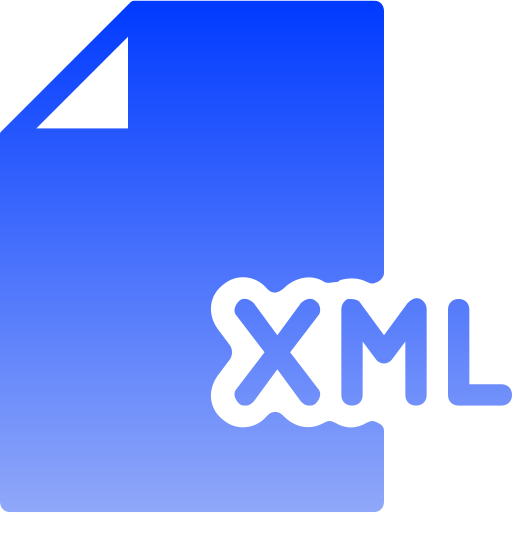

#  XML4Plex

# xml4plex
This is a Chrome extention

If you are using app.plex.tv as your web client, then this will show XML or JSON info for a movie, show, season or episode from a shared Plex Media Server.
If you have a Plex Pass, the server owner has a Plex Pass, and the server owner granted you download rights, you can also download the movie/episode as well as external subtitles

## Usage
* Please see the [Wiki for usage(https://github.com/ukdtom/xml4plex/wiki)

